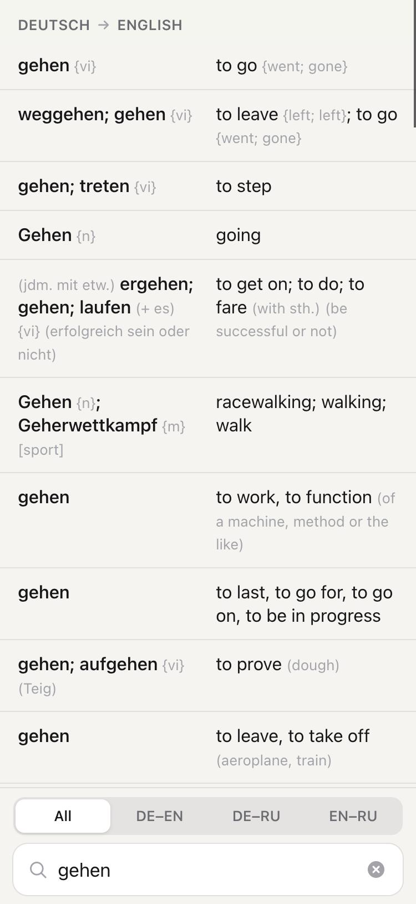
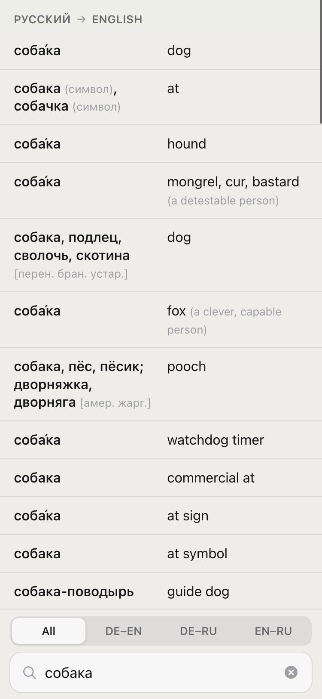
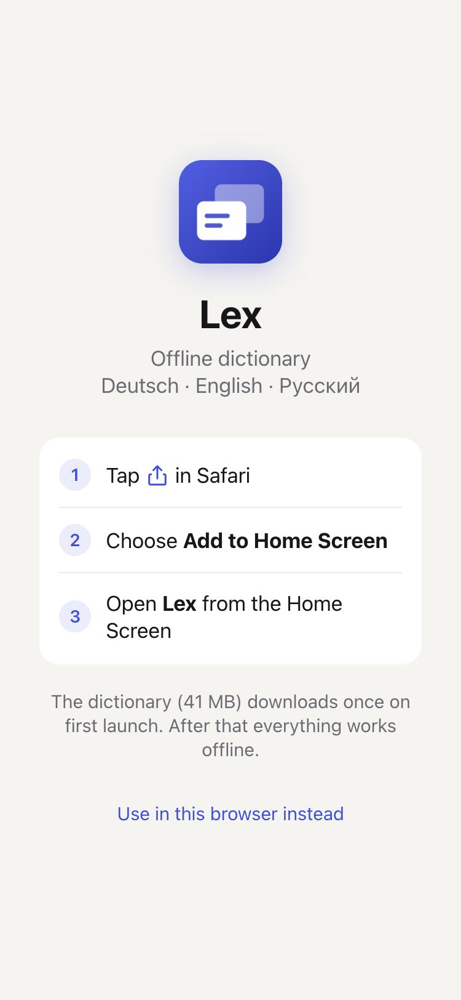

# Lex

Offline dictionary for Deutsch, English and Русский that installs on the iPhone Home Screen.
About one million entries, no ads, no account. Search runs on the device in a Rust/WASM core;
nothing is sent to a server.

<p>
  
  
  
</p>

## Install on iOS

1. Open **https://nikolazius.github.io/leopwa/** in Safari on the iPhone or iPad.
2. Tap the Share button, then **Add to Home Screen**.
3. Open **Lex** from the Home Screen. The dictionary (41 MB) downloads once on this first launch;
   keep the app open until it finishes. If the download is interrupted, it resumes where it stopped.

After that the app works without a connection. The download has to happen in the Home Screen app,
not in Safari, because iOS gives a Home Screen app its own storage.

To remove the dictionary from the device, open the info button on the start screen and choose
**Delete dictionary data**, or delete the app from the Home Screen.

## Layout

- `crates/core` — text normalisation, pack format and search (shared by builder and app)
- `crates/builder` — ingests the open sources and writes the pack; also a command-line query tool
- `crates/wasm` — the core compiled for the browser
- `app` — Svelte UI, dictionary worker, service worker
- `scripts/fetch.sh` — downloads the sources into `data/raw` (about 2.9 GB)

## Build

```sh
./scripts/build.sh          # everything, output in app/dist
npm --prefix app run dev    # development server
```

Query the pack from the terminal:

```sh
./target/release/builder query data/pack "gehen"
./target/release/builder bench data/pack
```

## Deploy

`app/dist` is a static site and needs HTTPS (service worker and on-device storage require it).
Pack files are split into parts of at most 4 MB, so any static host works.

For GitHub Pages, `./scripts/deploy.sh` rebuilds the site and force-pushes it as a single commit to
the `gh-pages` branch of `origin` (or of a remote URL passed as the first argument).

## Data sources

Ding (TU Chemnitz, GPL), English and Russian Wiktionary via kaikki.org and WikDict (CC BY-SA),
OpenRussian (CC BY-SA), FrequencyWords (CC BY-SA).
